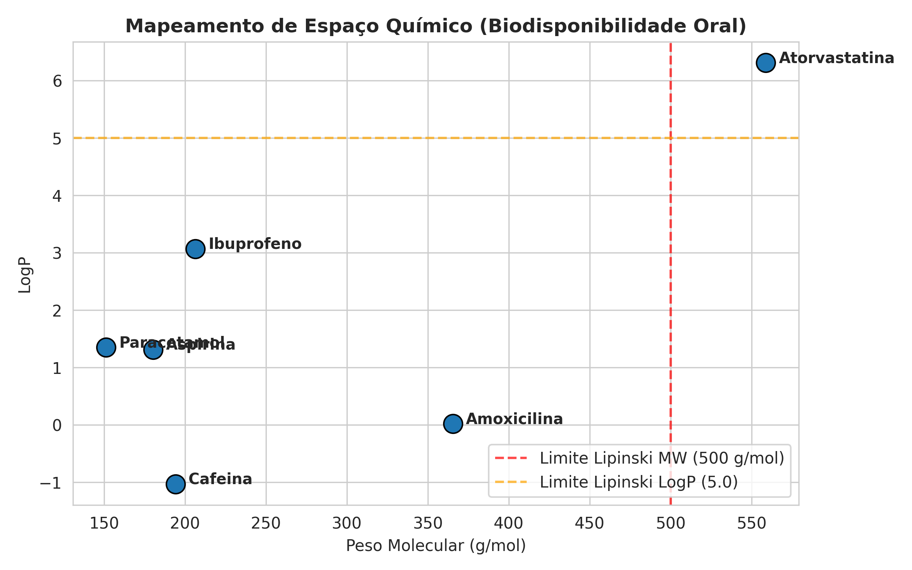
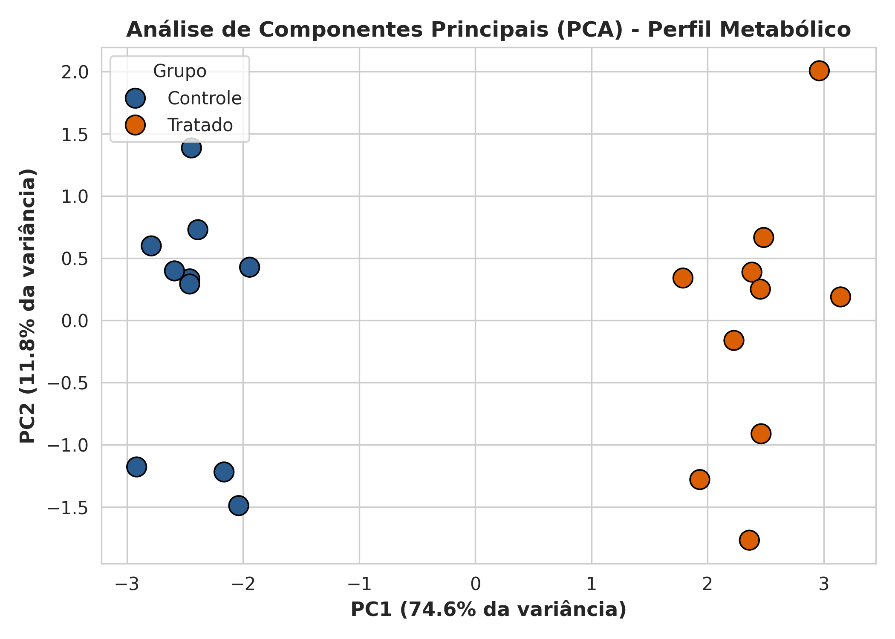
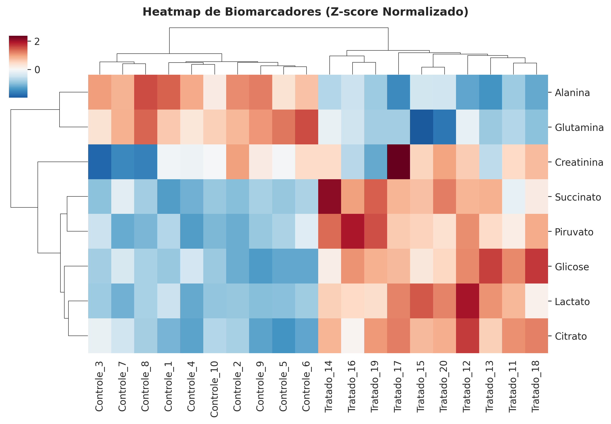

# Cheminformatics & Metabolomics Portfolio

**M.Sc. Analytical Chemist** specializing in asynchronous scientific data analysis, virtual screening, and publication-ready statistical visualization.

## Featured Projects

### 1. Drug Discovery & Chemical Space Mapping (Python / RDKit)
Automated calculation of physicochemical descriptors (Molecular Weight, LogP, H-Bond Donors/Acceptors) and Lipinski's Rule of Five filtering for oral bioavailability assessment.

### 2. Multivariate Metabolomics Analysis (PCA & Hierarchical Clustering)
Statistical normalization (auto-scaling), Principal Component Analysis (PCA), and biomarker clustering heatmaps for LC-MS / GC-MS datasets.

  
